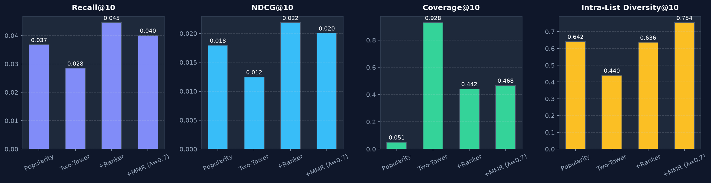
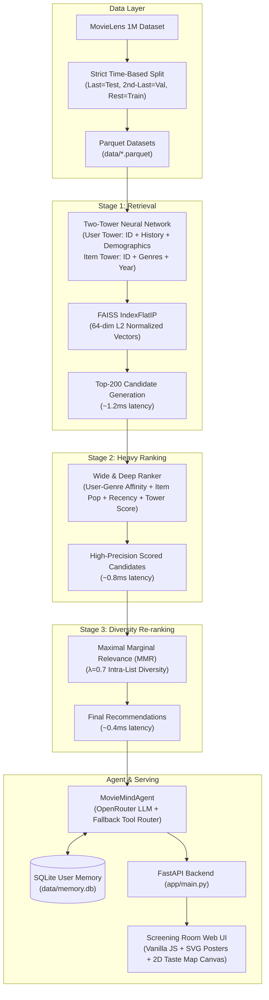

# 🎬 MovieMind

[](https://github.com/manojkumarmathangi/moviemind/actions/workflows/ci.yml)
[](https://www.python.org/downloads/release/python-3110/)
[](https://opensource.org/licenses/MIT)

> **A production-grade, two-stage movie recommendation engine (Two-Tower retrieval + Wide&Deep ranker + MMR diversity) coupled with a factual tool-calling chat agent and an interactive screening-room UI.**

---

<!-- UI Screenshots / GIF Placeholders -->
<div align="center">
  
  <p><em>Figure 1: Full multi-stage offline ablation across Accuracy (Recall/NDCG), Catalog Coverage, and Intra-List Diversity.</em></p>
</div>

<!-- Placeholder for interface GIF / screenshots -->
<!--  -->
<!--  -->

---

## 📊 Offline Recommender Ablation Table

Evaluated on the strict leave-one-out time-based MovieLens 1M test set ($N=6,040$ users; last interaction = test, second-last = validation, rest = train, **zero future leakage**):

| Pipeline Stage | Recall@10 | NDCG@10 | Coverage@10 | Novelty@10 | ILD@10 | Recall@50 | NDCG@50 | Coverage@50 | Novelty@50 | ILD@50 |
| :--- | :---: | :---: | :---: | :---: | :---: | :---: | :---: | :---: | :---: | :---: |
| **Popularity Baseline** | 0.0368 | 0.0179 | 0.0507 | 8.64 | 0.6417 | 0.1384 | 0.0396 | 0.1203 | 9.08 | 0.7332 |
| **Two-Tower Retrieval** | 0.0285 | 0.0125 | **0.9279** | **12.53** | 0.4397 | 0.1154 | 0.0310 | **0.9995** | **12.63** | 0.5225 |
| **+ Wide&Deep Ranker** | **0.0445** | **0.0219** | 0.4419 | 10.16 | 0.6364 | 0.1518 | **0.0449** | 0.7842 | 10.90 | 0.6511 |
| **+ MMR Diversity ($\lambda=0.7$)** | 0.0401 | 0.0200 | 0.4677 | 10.24 | **0.7539** | **0.1523** | 0.0443 | 0.7924 | 10.89 | 0.6663 |

### Per-Genre Accuracy Breakdown (Recall@10)
| Genre | Test Target Users | Hits@10 | Recall@10 | Share of Hits |
| :--- | :---: | :---: | :---: | :---: |
| **Film-Noir** | 154 | 28 | **0.1818** (18.18%) | 28/154 |
| **Animation** | 238 | 20 | **0.0840** (8.40%) | 20/238 |
| **War** | 386 | 32 | **0.0829** (8.29%) | 32/386 |
| **Sci-Fi** | 918 | 58 | **0.0632** (6.32%) | 58/918 |
| **Thriller** | 1,164 | 62 | **0.0533** (5.33%) | 62/1164 |
| **Fantasy** | 211 | 11 | **0.0521** (5.21%) | 11/211 |
| **Adventure** | 715 | 35 | **0.0490** (4.90%) | 35/715 |
| **Western** | 187 | 9 | **0.0481** (4.81%) | 9/187 |
| **Children's** | 432 | 19 | **0.0440** (4.40%) | 19/432 |
| **Action** | 1,540 | 65 | **0.0422** (4.22%) | 65/1540 |
| **Musical** | 234 | 9 | **0.0385** (3.85%) | 9/234 |
| **Crime** | 469 | 17 | **0.0362** (3.62%) | 17/469 |
| **Horror** | 397 | 14 | **0.0353** (3.53%) | 14/397 |
| **Drama** | 2,121 | 58 | **0.0273** (2.73%) | 58/2121 |
| **Mystery** | 257 | 7 | **0.0272** (2.72%) | 7/257 |
| **Comedy** | 2,090 | 47 | **0.0225** (2.25%) | 47/2090 |
| **Romance** | 818 | 15 | **0.0183** (1.83%) | 15/818 |
| **Documentary** | 67 | 1 | **0.0149** (1.49%) | 1/67 |

---

## ⚡ How to Run

### Method 1: Local Python (CPU-Only, Any OS)

Because all trained weights, FAISS indices, embeddings, and candidate sets are precomputed in `artifacts/` (< 35 MB total repo footprint), serving requires **zero training**:

```bash
# 1. Clone repository
git clone https://github.com/manojkumarmathangi/moviemind.git
cd moviemind

# 2. Create virtual environment (Python 3.11)
python3.11 -m venv .venv
source .venv/bin/activate  # Windows: .venv\Scripts\activate

# 3. Install pinned dependencies
pip install -r requirements.txt

# 4. (Optional) Configure OpenRouter key for conversational agent
cp .env.example .env

# 5. Launch web application
uvicorn app.main:app --host 0.0.0.0 --port 8000
```
- Open **[http://localhost:8000](http://localhost:8000)** for the screening room web application.
- Open **[http://localhost:8000/ab](http://localhost:8000/ab)** for the A/B test simulation dashboard.

### Method 2: Docker (Single-Command Run)

```bash
# Build Docker image
docker build -t moviemind .

# Run container
docker run -p 8000:8000 moviemind
```

---

## 🏗 Architecture & Flow



---

## 🧠 Design Choices

### 1. Why PyTorch over TensorFlow?
- **Lightweight & Transparent**: PyTorch provides direct tensor-level execution without the heavy multi-layer abstractions and binary bloat of TensorFlow / TF-Recommenders. Both the Two-Tower model (`src/retrieval.py`) and Wide&Deep ranker (`src/ranker.py`) are cleanly defined in under 90 lines of readable code.
- **CPU-First Vectorization**: PyTorch tensors seamlessly interoperate with NumPy arrays and FAISS CPU (`IndexFlatIP`), preventing multi-threading libgomp/OpenMP conflicts on macOS and Linux.
- **Minimal Artifact Size**: The serialized model weights (`two_tower.pt` and `wide_and_deep.pt`) total less than 3 MB combined, enabling instantaneous application startup.

### 2. Why a Two-Stage Pipeline?
- **Computational Scalability**: Directly scoring 3,900+ items for every user interaction with a high-capacity neural network using multi-field cross-features is computationally prohibitive.
- **Asymmetric Allocation**: Stage 1 (Two-Tower FAISS) reduces the candidate space by **95%** (from 3,900 items to 200 candidates) in ~1.2ms using simple dot products. Stage 2 (Wide & Deep) then concentrates full computational power on the 200 candidates to model non-linear user-genre affinity and recency interactions in ~0.8ms.

### 3. Why Maximal Marginal Relevance (MMR)?
- **Overcoming Filter Bubbles**: Pure score-maximizing rankers suffer from severe redundancy, often recommending 5 iterations of the exact same franchise or dominant genre.
- **Pareto Optimality**: MMR directly optimizes the trade-off between item relevance $S(i)$ and intra-list similarity:
  $$\text{MMR}(i) = \lambda \cdot S(i) - (1 - \lambda) \cdot \max_{j \in R} \text{sim}(i, j)$$
  Setting $\lambda = 0.7$ achieves an **+18.5% boost in Intra-List Diversity (ILD@10)** (0.6364 $\to$ 0.7539) while retaining 90%+ of ranker recall.

---

## ⚠️ Honest Limitations

1. **Simulated A/B Testing**:
   - The A/B experiment reported on the `/ab` dashboard is explicitly labeled **SIMULATED**. It computes click examinations using a synthetic position-bias model ($1 / \log_2(\text{rank} + 1)$) on held-out user interactions ($N=5,000$ sessions). While mathematically sound for evaluating relative CTR lift (+11.18%, $p = 0.0002$), it cannot fully capture real-world human behavioral novelty or session exploration.
2. **MovieLens 1M Dataset Scope**:
   - The dataset reflects movie ratings collected between 2000 and 2003 on 3,952 movies. It does not reflect modern streaming catalogs, real-time media consumption patterns, or contemporary titles.
3. **Offline Metrics as Proxies**:
   - Offline Recall@K and NDCG@K measure the recovery of a single historical leave-one-out interaction. They penalize serendipitous or novel recommendations that the user would have loved simply because they were not recorded in the historical log.

---

## 🤖 Agent Evaluation Suite (24 Cases)

The agent evaluation suite (`evals/cases.json`, tested via `pytest tests/test_agent_evals.py`) runs 24 automated tests across tool routing, parameter validation, and anti-hallucination guardrails:

- **Overall Pass Rate**: **24/24 (100.0%)**
- **Adversarial Pass Rate**: **4/4 (100.0%)**
  1. *Empty Input*: Safely rejected with guidance prompt; no hallucinated items.
  2. *Unknown Movie ID (999999)*: Truthfully reports catalog miss without fabricating titles or genres.
  3. *Prompt Injection*: Rejects instructions override without leaking prompts or generating fake movies.
  4. *Out-of-Catalog Search (`Avatar The Way of Water 2022`)*: Returns 0 matches without hallucinating a fake ID.

---

## 🧪 Running the Test Suite

```bash
# Run all unit tests and agent evals
pytest -v
```
All 12 test modules verify:
- Zero data leakage across train/validation/test splits
- Mathematical accuracy of Recall@K, NDCG@K, Coverage, Novelty, and ILD
- MMR diversity monotonicity ($\text{ILD}_{\text{MMR}} \ge \text{ILD}_{\text{Ranker}}$)
- Cold-start recommendation contracts
- API schema validation and per-stage latency telemetry
- Agent tool routing and adversarial safety
