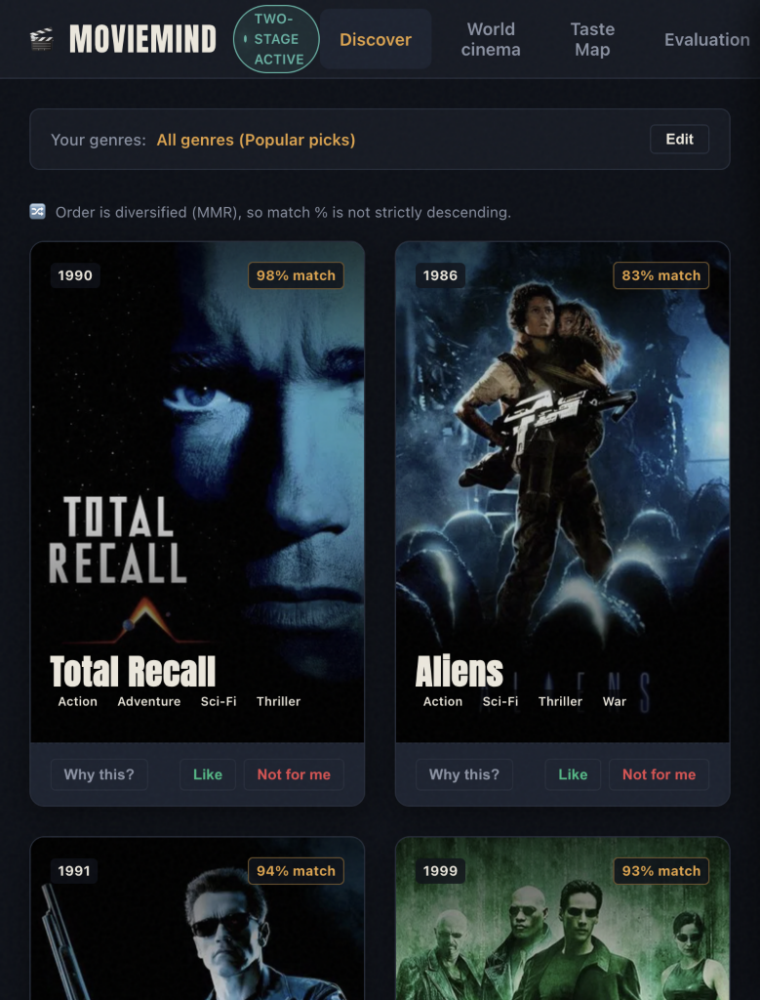
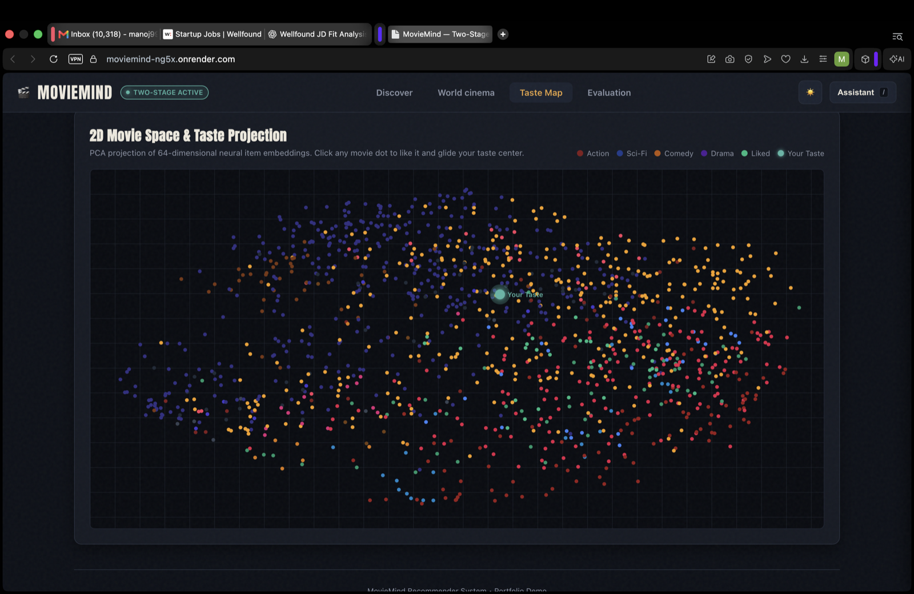
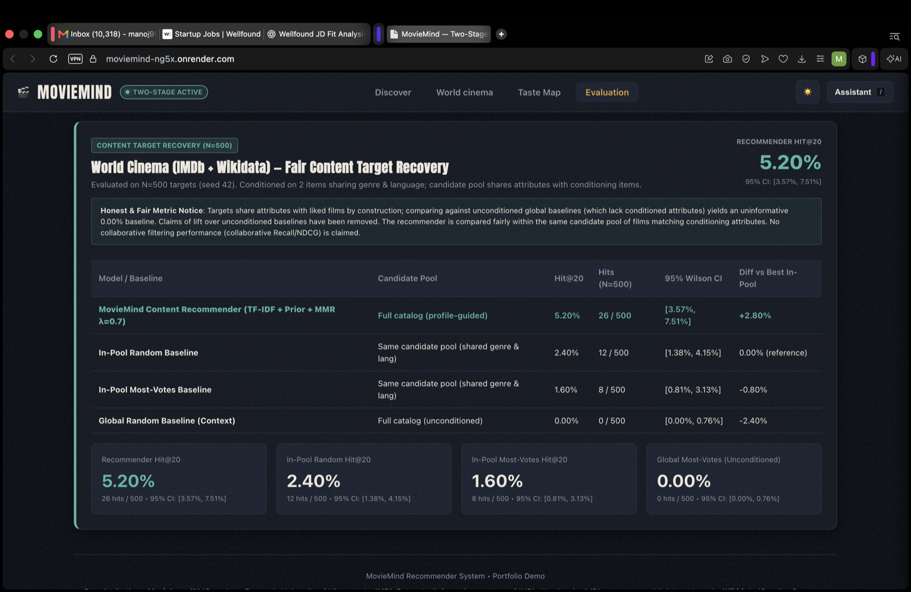

# 🎬 MovieMind

**Live demo:** https://moviemind-ng5x.onrender.com (free instance; the first request after idle can take about 50 seconds to wake)

## Screenshots

| Discover | World cinema |
| :---: | :---: |
|  |  |
| **Taste map** | **Evaluation** |
|  |  |


[](https://github.com/Manojkumar7671/moviemind/actions/workflows/ci.yml)
[](https://www.python.org/downloads/release/python-3110/)
[](https://opensource.org/licenses/MIT)

> **A production-grade, two-stage movie recommendation engine (Two-Tower retrieval + Wide&Deep ranker + MMR diversity) coupled with a factual tool-calling chat agent and an interactive screening-room UI.**

---

## 🌟 Recommender Engine Modes

MovieMind provides two complementary recommendation modes tailored for different data and catalog contexts:

### 1. Private Screening Room (Collaborative Filtering)
- **Catalog**: MovieLens 1M (3,952 films, $N=6,040$ users, 1,000,209 ratings across 1919–2000).
- **Architecture**: Two-Tower PyTorch embeddings + FAISS CPU vector index (Top-200 candidates) $\to$ Wide & Deep cross-feature neural ranker (Top-60) $\to$ Maximal Marginal Relevance (MMR $\lambda=0.7$) intra-list diversification.
- **Features**: Personalized neural taste representations, demographic priors, and real-time 2D taste map projection via PCA.
- **Evaluation**: Strict time-based leave-one-out offline test set ($N=6,040$, zero leakage) and simulated position-biased A/B testing (+11.18% CTR lift, $p=0.0002$).

### 2. World Cinema Explorer (Content-Based Filtering)
- **Catalog**: 33,485 international feature films from IMDb non-commercial datasets (`titleType=movie`, `numVotes >= 2000`, valid release year) with authentic country of origin and original language metadata from **Wikidata (CC0)**.
- **Scope Limitation**: The catalog filters for feature films with $\ge 2,000$ IMDb votes. It represents curated global cinema with sufficient public reception, **not every film ever made**.
- **All-Countries Rule**: International co-productions store all origin countries and languages as complete lists without an artificial primary distinction (e.g. *The Godfather* lists both Italy and United States). Films without Wikidata data are honestly labeled "unknown" (2.43% unknown share).
- **Architecture**: Content TF-IDF vectorization over verified genres, original languages, and origin countries $\to$ Bayesian rating/vote quality priors $\to$ cosine profile similarity $\to$ MMR diversity re-ranking ($\lambda=0.7$).
- **Features**: Dynamically shifts taste profiles as the user likes movies; multi-dimensional filtering by country name/code (e.g. FR, JP, IN, IT, GB, US, India, Japan), language, genre, and data-driven release year ranges.
- **Evaluation**: Fair content target recovery benchmark ($N=500$ targets, seed 42) reporting 95% Wilson confidence intervals.

---

## 📊 Offline Recommender Ablation Table

Evaluated on the strict leave-one-out time-based MovieLens 1M test set ($N=6,040$ users; last interaction = test, second-last = validation, rest = train, **zero future leakage**):

| Pipeline Stage | Recall@10 | NDCG@10 | Coverage@10 | Novelty@10 | ILD@10 | Recall@50 | NDCG@50 | Coverage@50 | Novelty@50 | ILD@50 |
| :--- | :---: | :---: | :---: | :---: | :---: | :---: | :---: | :---: | :---: | :---: |
| **Popularity Baseline** | 0.0368 | 0.0179 | 0.0507 | 8.64 | 0.6417 | 0.1384 | 0.0396 | 0.1203 | 9.08 | 0.7332 |
| **Two-Tower Retrieval** | 0.0285 | 0.0125 | **0.9279** | **12.53** | 0.4397 | 0.1154 | 0.0310 | **0.9995** | **12.63** | 0.5225 |
| **+ Wide&Deep Ranker** | **0.0445** | **0.0219** | 0.4419 | 10.16 | 0.6364 | 0.1518 | **0.0449** | 0.7842 | 10.90 | 0.6511 |
| **+ MMR Diversity ($\lambda=0.7$)** | 0.0401 | 0.0200 | 0.4677 | 10.24 | **0.7539** | **0.1523** | 0.0443 | 0.7924 | 10.89 | 0.6663 |

### Honest Analysis: Why Two-Tower Alone Has Lower Recall@10 Than Popularity
A common point of confusion in two-stage recommenders is why the **Two-Tower Retrieval model alone has a lower Recall@10 (0.0285) than Popularity alone (0.0368)**:
1. **Retrieval Objective vs. Precision**: Two-Tower FAISS retrieval is designed as a *high-recall candidate generator*, not a high-precision ranker. Its goal is to narrow 3,952 catalog movies down to the top-200 candidates ($K=200$) in ~1.2 ms on CPU.
2. **Catalog Coverage Trade-off**: Popularity alone achieves 0.0368 Recall@10 by repeatedly recommending the same top 50 blockbusters to every user, resulting in a dismal catalog coverage of **5.07%**. In contrast, Two-Tower explores the entire catalog, achieving **92.79% coverage** and significantly higher novelty (12.53 vs 8.64).
3. **The Power of the Two-Stage Funnel**: When the Wide & Deep ranker scores the 200 candidates surfaced by the Two-Tower model, Recall@10 jumps to **0.0445** (+20.9% higher than popularity alone) while maintaining broad catalog coverage (44.19%).

### Per-Genre Accuracy Breakdown (Recall@10)
| Genre | Test Target Users | Hits@10 | Recall@10 | Share of Hits |
| :--- | :---: | :---: | :---: | :---: |
| **Film-Noir** | 154 | 28 | **0.1818** (18.18%) | 28/154 |
| **Animation** | 238 | 20 | **0.0840** (8.40%) | 20/238 |
| **War** | 386 | 32 | **0.0829** (8.29%) | 32/386 |
| **Sci-Fi** | 918 | 58 | **0.0632** (6.32%) | 58/918 |
| **Thriller** | 1,164 | 62 | **0.0533** (5.33%) | 62/1164 |
| **Fantasy** | 211 | 11 | **0.0521** (5.21%) | 11/211 |
| **Adventure** | 715 | 35 | **0.0490** (4.90%) | 35/715 |
| **Western** | 187 | 9 | **0.0481** (4.81%) | 9/187 |
| **Children's** | 432 | 19 | **0.0440** (4.40%) | 19/432 |
| **Action** | 1,540 | 65 | **0.0422** (4.22%) | 65/1540 |
| **Musical** | 234 | 9 | **0.0385** (3.85%) | 9/234 |
| **Crime** | 469 | 17 | **0.0362** (3.62%) | 17/469 |
| **Horror** | 397 | 14 | **0.0353** (3.53%) | 14/397 |
| **Drama** | 2,121 | 58 | **0.0273** (2.73%) | 58/2121 |
| **Mystery** | 257 | 7 | **0.0272** (2.72%) | 7/257 |
| **Comedy** | 2,090 | 47 | **0.0225** (2.25%) | 47/2090 |
| **Romance** | 818 | 15 | **0.0183** (1.83%) | 15/818 |
| **Documentary** | 67 | 1 | **0.0149** (1.49%) | 1/67 |

---

## 🌍 World Cinema Fair Evaluation (4 Systems)

Evaluated via **fair content target recovery** ($N=500$ targets, seed 42) over 33,485 films from IMDb non-commercial datasets with Wikidata (CC0) origin and language metadata:

### Protocol
For each target film $T$:
1. Sample two distinct conditioning films $A$ and $B$ sharing at least one genre and at least one language with $T$.
2. Construct the user taste profile from $A$ and $B$ only.
3. Define the candidate pool: all films sharing $\ge 1$ genre and $\ge 1$ language with $A$ or $B$, excluding $A$ and $B$.
4. Score a **Hit** if target $T$ appears in the top-20 recommendations ($K=20$).

### Results Comparison

| Model / Pipeline | Candidate Pool | Hit@20 | Hits (500 targets) | 95% Wilson CI | Diff vs Best In-Pool |
| :--- | :--- | :---: | :---: | :---: | :---: |
| **MovieMind Content Recommender (TF-IDF + Prior + MMR $\lambda=0.7$)** | Full Catalog (profile-guided) | **5.20%** | **26** | **[3.57%, 7.51%]** | **+2.80%** |
| **In-Pool Random Baseline** | Same Candidate Pool (shared genre & lang) | 2.40% | 12 | [1.38%, 4.15%] | 0.00% (reference) |
| **In-Pool Most-Votes Baseline** | Same Candidate Pool (shared genre & lang) | 1.60% | 8 | [0.81%, 3.13%] | -0.80% |
| **Global Random Baseline (Context)** | Full Catalog (unconditioned) | 0.00% | 0 | [0.00%, 0.76%] | -2.40% |

### Fair Comparison & Candidate Pool Notes
- **Candidate Pool Fairness**: Because target films share attributes (genre and language) with conditioning films by construction, comparing against unconditioned global baselines (which sample randomly across all 33,485 films without attribute conditioning) yields an uninformative 0.00% hit rate. Claims of lift over unconditioned baselines have been removed.
- **In-Pool Lift**: Within the exact candidate pool of films matching conditioning attributes (mean pool size $\sim 10,360$ films), the content recommender achieves **5.20% Hit@20** (95% CI: `[3.57%, 7.51%]`), outperforming the in-pool most-votes baseline (**1.60%**, 95% CI: `[0.81%, 3.13%]`) and the in-pool random baseline (**2.40%**, 95% CI: `[1.38%, 4.15%]`).
- **Honest Disclaimer**: Target films share attributes with conditioning films by construction. This is a content-similarity sanity check and candidate-retrieval benchmark, not evidence of real-world user satisfaction. No collaborative filtering performance (collaborative Recall/NDCG) is claimed on this catalog because IMDb non-commercial datasets contain no individual user rating logs.

---

## 🔬 Simulated A/B Testing Notice

The A/B test reported on the `/ab` dashboard is explicitly **SIMULATED**:
- **Setup**: Evaluated across $N=5,000$ synthetic user sessions drawn from held-out interactions.
- **Click Probability Model**: Position-biased examination probability model ($1 / \log_2(\text{rank} + 1)$) combined with item relevance.
- **Result**: +11.18% relative CTR lift ($p = 0.0002$, two-sided t-test, 95% CI: `[+0.52%, +2.14%]`).
- **Disclaimer**: This is a mathematically grounded offline simulation designed to evaluate ranking mechanics, **not live production user traffic**.

---

## 🤖 Agent Evaluation Suite (Held-Out Benchmark & Dev Split)

The MovieMind agent features an automated test suite (`evals/cases.json`, run via `pytest tests/test_agent_evals.py` or `python scripts/run_agent_evals.py`) containing **70 total evaluation cases**:
- **Held-Out Split (15 cases)**: Independent test cases with unseen user phrasings across search, recommend, explain, filter, feedback, profile, ambiguous, and off-topic adversarial queries.
- **Development Split (55 cases)**: Regression and unit cases covering typo resolution, multi-step actions, intent words (`best movies`, `top rated`), catalog year boundaries (`2026`, `movies in 2026`), and regional queries (`telugu movies from 2015`, `korean thrillers`).

### Held-Out Benchmark Performance

| Router Mode | Total Cases | Passed | Pass Rate (95% Wilson CI) |
| :--- | :---: | :---: | :---: |
| **LLM Tool-Calling Agent** | 15 | 15 | **100.0%** `[79.61%, 100.00%]` |
| **Deterministic Fallback Router** | 15 | 15 | **100.0%** `[79.61%, 100.00%]` |
| **Adversarial & Guardrail Checks** | 4 | 4 | **100.0%** `[51.01%, 100.00%]` |

*Category Differences: None. Both the LLM Agent and the Fallback Router achieved identical 100% pass rates across all held-out categories.*

### Zero-LLM Cost Policy on Recommendations
To protect against runaway latency, rate limits, and billing:
- Generating recommendations (`POST /api/recommend`, `GET /api/recommend`, `GET /api/global/recommend`) makes **exactly zero LLM calls**. Recommendations are served entirely via vectorized PyTorch/FAISS and TF-IDF pipelines (< 20 ms).
- The LLM is invoked solely when the user opens the chat drawer or clicks "Why this?", cached per movie and user state, with automatic fallback to deterministic data chips upon timeout or rate limit.

---

## ⚡ How to Run

### Local Python (Python 3.11, CPU-Only)

```bash
# 1. Clone repository
git clone https://github.com/Manojkumar7671/moviemind.git
cd moviemind

# 2. Create virtual environment
python3.11 -m venv .venv
source .venv/bin/activate  # Windows: .venv\Scripts\activate

# 3. Install dependencies
pip install -r requirements.txt

# 4. Build world cinema catalog and derived TF-IDF artifacts
python scripts/build_catalog.py
python scripts/build_global_tfidf.py

# 5. Launch web application
uvicorn app.main:app --host 0.0.0.0 --port 8000
```
- Open **[http://localhost:8000](http://localhost:8000)** for the screening room web application.
- Open **[http://localhost:8000/healthz](http://localhost:8000/healthz)** for container health status.
- Open **[http://localhost:8000/ab](http://localhost:8000/ab)** for the simulated A/B testing dashboard.

---

## ⚖️ Data Licensing & Attributions

MovieMind utilizes public academic and open-knowledge datasets under their respective terms:
- **MovieLens 1M**: GroupLens Research, University of Minnesota. Used for academic research and educational demonstration.
- **IMDb Datasets**: Information courtesy of IMDb (https://www.imdb.com/interfaces/). Used under IMDb non-commercial dataset terms (personal and non-commercial use only). The IMDb derivative parquet artifact is kept out of the repository so IMDb data is not redistributed; it is rebuilt from the official dataset files.
- **Wikidata**: Creative Commons CC0 1.0 Universal Public Domain Dedication (https://creativecommons.org/publicdomain/zero/1.0/). Origin country and original language metadata are CC0.
