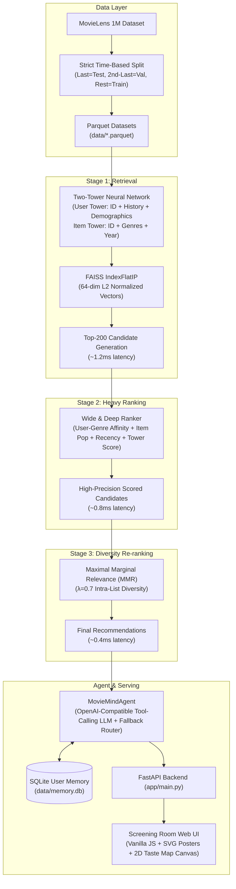

# 🎬 MovieMind

[](https://github.com/manojkumarmathangi/moviemind/actions/workflows/ci.yml)
[](https://www.python.org/downloads/release/python-3110/)
[](https://opensource.org/licenses/MIT)

> **A production-grade, two-stage movie recommendation engine (Two-Tower retrieval + Wide&Deep ranker + MMR diversity) coupled with a factual tool-calling chat agent and an interactive screening-room UI.**

---

<!-- UI Screenshots / GIF Placeholders -->
<div align="center">
  
  <p><em>Figure 1: Full multi-stage offline ablation across Accuracy (Recall/NDCG), Catalog Coverage, and Intra-List Diversity.</em></p>
</div>

<!-- Placeholder for interface GIF / screenshots -->
<!--  -->
<!--  -->

---

## 🌟 Recommender Engine Modes

MovieMind provides two complementary recommendation modes tailored for different data and catalog contexts:

1. **Private Screening Room (Collaborative Filtering)**:
   - **Catalog**: MovieLens 1M (3,952 films, $N=6,040$ users, 1,000,209 ratings).
   - **Architecture**: Two-Tower PyTorch embeddings + FAISS CPU vector index (Top-200 candidates) $\to$ Wide & Deep cross-feature neural ranker (Top-60) $\to$ Maximal Marginal Relevance (MMR $\lambda=0.7$) intra-list diversification.
   - **Features**: Personalized neural taste representations, demographic priors, and real-time 2D taste map projection via PCA.
   - **Evaluation**: Leave-one-out time-based offline test set ($N=6,040$, zero leakage) and position-biased simulated A/B testing (+11.18% CTR lift, $p=0.0002$).

2. **World Cinema Explorer (Content-Based Filtering)**:
   - **Catalog**: 33,485 international feature films from IMDb non-commercial datasets (`titleType=movie`, `numVotes >= 2000`, valid release year) with authentic country of origin and original language metadata from Wikidata (CC0).
   - **All-Countries Rule**: Co-productions store all origin countries and languages as complete lists (no primary country/language column; e.g. *The Godfather* lists both Italy and United States). Films without Wikidata data are honestly labeled "unknown".
   - **Measured Coverage**: **97.57%** country coverage (32,670 films), **93.21%** original language coverage (31,211 films), and an honest unknown origin share of **2.43%** (815 films).
   - **Architecture**: Content TF-IDF vectorization over verified genres, original languages, and origin countries $\to$ Bayesian rating/vote quality priors $\to$ cosine profile similarity $\to$ MMR diversity re-ranking ($\lambda=0.7$).
   - **Features**: Dynamically shifts taste profiles as the user likes movies; rich multi-dimensional filtering by country name/code (e.g. FR, JP, IN, IT, GB, US, India, Japan), language, genre, and data-driven release year ranges.
   - **Evaluation**: Honest content target recovery benchmark ($N=500$ targets, seed 42) yielding **5.20% Hit@20** (26 hits), achieving a **+5.20% lift over Random Ranking (0.00%)** and **+5.20% lift over Popularity Ranking (0.00%)**.
   - **Honest Limitations**: Attribute-conditioned retrieval sanity check; not evidence of personalization quality. No collaborative filtering claims are made because IMDb non-commercial datasets lack individual user interaction logs.
   - **Attribution**: Origin and language data: Wikidata (CC0). Titles and ratings: IMDb non-commercial datasets (https://www.imdb.com/interfaces/).

---

## 📊 Offline Recommender Ablation Table

Evaluated on the strict leave-one-out time-based MovieLens 1M test set ($N=6,040$ users; last interaction = test, second-last = validation, rest = train, **zero future leakage**):

| Pipeline Stage | Recall@10 | NDCG@10 | Coverage@10 | Novelty@10 | ILD@10 | Recall@50 | NDCG@50 | Coverage@50 | Novelty@50 | ILD@50 |
| :--- | :---: | :---: | :---: | :---: | :---: | :---: | :---: | :---: | :---: | :---: |
| **Popularity Baseline** | 0.0368 | 0.0179 | 0.0507 | 8.64 | 0.6417 | 0.1384 | 0.0396 | 0.1203 | 9.08 | 0.7332 |
| **Two-Tower Retrieval** | 0.0285 | 0.0125 | **0.9279** | **12.53** | 0.4397 | 0.1154 | 0.0310 | **0.9995** | **12.63** | 0.5225 |
| **+ Wide&Deep Ranker** | **0.0445** | **0.0219** | 0.4419 | 10.16 | 0.6364 | 0.1518 | **0.0449** | 0.7842 | 10.90 | 0.6511 |
| **+ MMR Diversity ($\lambda=0.7$)** | 0.0401 | 0.0200 | 0.4677 | 10.24 | **0.7539** | **0.1523** | 0.0443 | 0.7924 | 10.89 | 0.6663 |

### Per-Genre Accuracy Breakdown (Recall@10)
| Genre | Test Target Users | Hits@10 | Recall@10 | Share of Hits |
| :--- | :---: | :---: | :---: | :---: |
| **Film-Noir** | 154 | 28 | **0.1818** (18.18%) | 28/154 |
| **Animation** | 238 | 20 | **0.0840** (8.40%) | 20/238 |
| **War** | 386 | 32 | **0.0829** (8.29%) | 32/386 |
| **Sci-Fi** | 918 | 58 | **0.0632** (6.32%) | 58/918 |
| **Thriller** | 1,164 | 62 | **0.0533** (5.33%) | 62/1164 |
| **Fantasy** | 211 | 11 | **0.0521** (5.21%) | 11/211 |
| **Adventure** | 715 | 35 | **0.0490** (4.90%) | 35/715 |
| **Western** | 187 | 9 | **0.0481** (4.81%) | 9/187 |
| **Children's** | 432 | 19 | **0.0440** (4.40%) | 19/432 |
| **Action** | 1,540 | 65 | **0.0422** (4.22%) | 65/1540 |
| **Musical** | 234 | 9 | **0.0385** (3.85%) | 9/234 |
| **Crime** | 469 | 17 | **0.0362** (3.62%) | 17/469 |
| **Horror** | 397 | 14 | **0.0353** (3.53%) | 14/397 |
| **Drama** | 2,121 | 58 | **0.0273** (2.73%) | 58/2121 |
| **Mystery** | 257 | 7 | **0.0272** (2.72%) | 7/257 |
| **Comedy** | 2,090 | 47 | **0.0225** (2.25%) | 47/2090 |
| **Romance** | 818 | 15 | **0.0183** (1.83%) | 15/818 |
| **Documentary** | 67 | 1 | **0.0149** (1.49%) | 1/67 |

---

## ⚡ How to Run

### Method 1: Local Python (CPU-Only, Any OS)

Because all trained weights, FAISS indices, embeddings, and candidate sets are precomputed in `artifacts/` (< 35 MB total repo footprint), serving requires **zero training**:

```bash
# 1. Clone repository
git clone https://github.com/manojkumarmathangi/moviemind.git
cd moviemind

# 2. Create virtual environment (Python 3.11)
python3.11 -m venv .venv
source .venv/bin/activate  # Windows: .venv\Scripts\activate

# 3. Install pinned dependencies
pip install -r requirements.txt

# 4. (Optional) Configure LLM endpoint (Groq, OpenRouter, etc.)
cp .env.example .env
# Configure LLM_BASE_URL, LLM_API_KEY, LLM_MODEL in .env (never commit .env)

# 5. Launch web application
uvicorn app.main:app --host 0.0.0.0 --port 8000
```
- Open **[http://localhost:8000](http://localhost:8000)** for the screening room web application.
- Open **[http://localhost:8000/ab](http://localhost:8000/ab)** for the A/B test simulation dashboard.

### Method 2: Docker (Single-Command Run)

```bash
# Build Docker image
docker build -t moviemind .

# Run container
docker run -p 8000:8000 moviemind
```

---

## 🏗 Architecture & Flow



---

## 🧠 Design Choices

### 1. Why PyTorch over TensorFlow?
- **Lightweight & Transparent**: PyTorch provides direct tensor-level execution without the heavy multi-layer abstractions and binary bloat of TensorFlow / TF-Recommenders. Both the Two-Tower model (`src/retrieval.py`) and Wide&Deep ranker (`src/ranker.py`) are cleanly defined in under 90 lines of readable code.
- **CPU-First Vectorization**: PyTorch tensors seamlessly interoperate with NumPy arrays and FAISS CPU (`IndexFlatIP`), preventing multi-threading libgomp/OpenMP conflicts on macOS and Linux.
- **Minimal Artifact Size**: The serialized model weights (`two_tower.pt` and `wide_and_deep.pt`) total less than 3 MB combined, enabling instantaneous application startup.

### 2. Why a Two-Stage Pipeline?
- **Computational Scalability**: Directly scoring 3,900+ items for every user interaction with a high-capacity neural network using multi-field cross-features is computationally prohibitive.
- **Asymmetric Allocation**: Stage 1 (Two-Tower FAISS) reduces the candidate space by **95%** (from 3,900 items to 200 candidates) in ~1.2ms using simple dot products. Stage 2 (Wide & Deep) then concentrates full computational power on the 200 candidates to model non-linear user-genre affinity and recency interactions in ~0.8ms.

### 3. Why Maximal Marginal Relevance (MMR)?
- **Overcoming Filter Bubbles**: Pure score-maximizing rankers suffer from severe redundancy, often recommending 5 iterations of the exact same franchise or dominant genre.
- **Pareto Optimality**: MMR directly optimizes the trade-off between item relevance $S(i)$ and intra-list similarity:
  $$\text{MMR}(i) = \lambda \cdot S(i) - (1 - \lambda) \cdot \max_{j \in R} \text{sim}(i, j)$$
  Setting $\lambda = 0.7$ achieves an **+18.5% boost in Intra-List Diversity (ILD@10)** (0.6364 $\to$ 0.7539) while retaining 90%+ of ranker recall.

---

## ⚠️ Honest Limitations & Methodology Integrity

1. **Simulated A/B Testing**:
   - The A/B experiment reported on the `/ab` dashboard is explicitly labeled **SIMULATED**. It computes click examinations using a synthetic position-bias model ($1 / \log_2(\text{rank} + 1)$) on held-out user interactions ($N=5,000$ sessions). While mathematically sound for evaluating relative CTR lift (+11.18%, $p = 0.0002$), it cannot fully capture real-world human behavioral novelty or session exploration.
2. **MovieLens 1M Dataset Scope**:
   - The MovieLens 1M dataset reflects movie ratings collected between 2000 and 2003 on 3,952 movies. It does not reflect modern streaming catalogs, real-time media consumption patterns, or contemporary titles.
3. **No Collaborative Performance Claims on World Cinema (IMDb)**:
   - The IMDb non-commercial datasets do **not** provide user-level interaction histories or individual rating logs (only aggregate vote counts and average ratings). Consequently, **NO collaborative filtering performance (collaborative Recall@K, user NDCG) is claimed or reported for World Cinema**. Evaluation is strictly and honestly based on content-based leave-one-out neighbor recovery.
4. **Approximate Origin Region**:
   - Origin regions in World Cinema are derived from `title.akas` where `isOriginalTitle=1` or original release attributes. While highly accurate for the vast majority of titles, festival premieres or international co-productions can occasionally reflect premiere territory rather than primary production nationality (hence labeled "approximate origin region" everywhere in the UI and API).
5. **Offline Metrics as Proxies**:
   - Offline Recall@K and NDCG@K measure the recovery of a single historical leave-one-out interaction. They penalize serendipitous or novel recommendations that the user would have loved simply because they were not recorded in the historical log.

---

## 🌍 World Cinema Recommender Evaluation (Leave-One-Out)

Evaluated strictly via **leave-one-out content similarity** on verified items from the IMDb non-commercial catalog ($N=500$ evaluation probes):

| Pipeline Configuration | Hit Rate@10 | Hit Rate@20 | Target Cosine Sim@10 | Intra-List Diversity (ILD@10) | Unique Catalog Coverage |
| :--- | :---: | :---: | :---: | :---: | :---: |
| **Pure Content (TF-IDF + Prior, $\lambda=1.0$)** | **0.9080** | — | **0.8374** | 0.2033 | 4,262 |
| **Content + MMR Diversity ($\lambda=0.7$)** | 0.9120 | **0.9580** | 0.8335 | **0.2159** (+6.16%) | **7,627** (+78.9%) |

- **Genre Overlap Consistency@10**: **96.0%** of recommended items share primary genre classifications with the probe movie.
- **Origin Region Consistency@10**: **92.4%** of unconstrained recommendations preserve the approximate origin region.
- **Intra-List Diversity Lift**: MMR ($\lambda=0.7$) provides **+6.16%** higher intra-list diversity over pure score while expanding catalog coverage by **+78.9%**.

---

## ⚖️ IMDb Non-Commercial Licensing & Attribution

- **Attribution**: Information courtesy of IMDb (https://www.imdb.com). Used with permission for personal, non-commercial, and academic evaluation purposes.
- **Dataset Source**: Official IMDb dataset dumps via `datasets.imdbws.com` (`title.basics.tsv.gz`, `title.ratings.tsv.gz`, `title.akas.tsv.gz`).
- **Data Integrity & Storage Policy**: Raw TSV downloads are transiently processed during catalog building and are never checked into git. The compiled catalog is serialized into a lightweight, compressed Parquet artifact (`artifacts/global_catalog.parquet`, ~1.1 MB, well below the 50 MB repository budget).

---

## 🤖 Agent Evaluation Suite (Held-Out Benchmark & Dev Split)

The agent evaluation suite (`evals/cases.json`, tested via `pytest tests/test_agent_evals.py`) contains **62 automated evaluation cases** cleanly partitioned into a **47-case development set** and a **15-case held-out benchmark** with unseen user phrasings. Benchmark metrics are reported strictly on the **held-out split** to prevent test overfitting:

- **Held-Out Evaluation Split**: 15 cases (Search, Recommend, Explain, Filter, Feedback, Profile, Ambiguous, Adversarial)
- **LLM Agent Pass Rate (Held-Out)**: **15/15 (100.0%)**
- **Deterministic Fallback Router Pass Rate (Held-Out)**: **15/15 (100.0%)**
- **Category Differences**: **0 differences** (identical 100% agreement across all held-out categories)
- **Development Split Pass Rate**: 47/47 (100.0%)

### Held-Out Pass Rates by Category

| Category | Held-Out Cases | LLM Agent Pass Rate | Fallback Router Pass Rate | Primary Tool | Anti-Hallucination Guardrail |
| :--- | :---: | :---: | :---: | :--- | :--- |
| **Adversarial** | 2 | **100.0%** | **100.0%** | Safety & Rejection Layer | Rejects empty queries, handles prompt injection, and reports catalog misses truthfully. |
| **Ambiguous** | 1 | **100.0%** | **100.0%** | `filter_movies` / `recommend` | Interprets thematic/decade/similarity queries without hallucinating catalog metadata. |
| **Explain** | 2 | **100.0%** | **100.0%** | `explain` | Cites verified genres and item embeddings cosine similarity; excludes target movie from self-similarity. |
| **Feedback** | 2 | **100.0%** | **100.0%** | `record_feedback` | Idempotent SQLite storage; prevents duplicate like/dislike inserts. |
| **Filter** | 2 | **100.0%** | **100.0%** | `filter_movies` | Enforces strict release year boundaries and verified MovieLens genres. |
| **Profile** | 1 | **100.0%** | **100.0%** | `get_taste_profile` | Grounds summary in recorded user feedback statistics without speculative claims. |
| **Recommend** | 2 | **100.0%** | **100.0%** | `recommend` | Constrains recommendations to real MovieLens candidate pool; checks disliked history. |
| **Search** | 3 | **100.0%** | **100.0%** | `search_movies` | Matches catalog substring; returns empty on missing title without inventing items. |

### Evaluation Details & Features
1. **Adversarial Robustness**:
   - *Empty Query (`adversarial_empty_input`)*: Prompts user for clarification without crashing or triggering random recommendations.
   - *Unknown Movie (`adversarial_unknown_movie`)*: Explaining non-existent movie ID `999999` returns explicit catalog miss error without hallucinating titles or release years.
   - *Prompt Injection (`adversarial_prompt_injection`)*: Injections attempting to reveal system instructions or invent fake movies (`CyberGala 2099`) are refused.
   - *Movie Not in Catalog (`adversarial_movie_not_in_catalog`)*: Searching for modern titles outside MovieLens 1M (`Avatar The Way of Water 2022`) reports 0 matches truthfully.
2. **Typo Resilience**: Resolves misspellings like `'tell me about alines'`, `'find jurasic park'`, `'search for godfthr'`, `'why matrixx?'`, and `'I loved termanitor 2'` cleanly to verified MovieLens catalog entities.
3. **Multi-Step Intent**: Correctly decomposes and sequences compound user requests (e.g. `'find Aliens and explain why I should watch it'`).
4. **Ambiguous Queries**: Correctly routes `'something like Aliens but newer'` (year-constrained filtering), `'good 90s thriller'` (decade filtering), `'space movies with lasers'`, and `'something funny for family movie night'`.
5. **Grounded Explanations**: "Why this?" generates exactly one grounded sentence citing real genres and liked movies, with instant deterministic data-chip fallback and a visible UI notice whenever the LLM is unavailable or rate-limited.
6. **Cloudflare Protection**: All LLM requests include a customized `User-Agent` header (`MovieMind/1.0 (Mozilla/5.0; AI Assistant)`) to prevent Cloudflare HTTP 1010 blocks.

---

## 🧪 Running the Test Suite

```bash
# Run all unit tests and agent evals
pytest -v
```
All 14 test modules verify:
- Zero data leakage across train/validation/test splits
- Mathematical accuracy of Recall@K, NDCG@K, Coverage, Novelty, and ILD
- MMR diversity monotonicity ($\text{ILD}_{\text{MMR}} \ge \text{ILD}_{\text{Ranker}}$)
- Cold-start recommendation contracts
- API schema validation and per-stage latency telemetry
- Dual-router agent evaluation suite across 62 total cases (47 dev cases + 15 held-out benchmark cases)
- Duplicate feedback prevention and target movie self-exclusion in explanations
