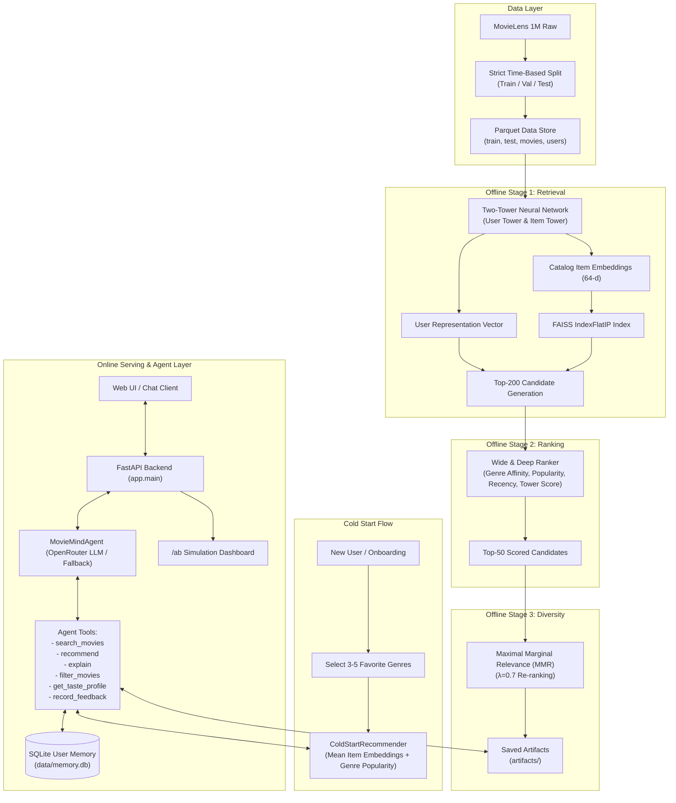

# MovieMind Architecture

MovieMind implements a production-grade, two-stage recommendation system augmented with an LLM tool-calling conversational agent.

## System Topology & Flow

## Architecture Stages

1. **Candidate Retrieval (Two-Tower Model)**:
   - **User Tower**: Consumes user ID embedding, demographics (gender, binned age, occupation), and historical mean rating strictly computed on train split.
   - **Item Tower**: Consumes movie ID embedding, 18-dim multi-hot genre projection, and normalized release year.
   - **Loss**: InfoNCE with in-batch negatives.
   - **Vector Index**: FAISS `IndexFlatIP` indexing L2-normalized 64-dimensional vectors. Sub-millisecond candidate retrieval.

2. **Heavy Ranking (Wide & Deep Model)**:
   - **Wide Component**: Linear model capturing explicit cross-features: user-genre historical affinity, item popularity, recency, and retrieval tower score.
   - **Deep Component**: User & item entity embeddings combined with dense cross-feature activations passed through a deep multi-layer perceptron.
   - Re-ranks candidate pools from 200 down to high-precision ranked lists.

3. **Diversity Re-ranking (MMR)**:
   - Balances relevance $S_{\text{norm}}(i)$ with item-to-item genre similarity:
     $$\text{MMR}(i) = \lambda \cdot S_{\text{norm}}(i) - (1 - \lambda) \cdot \max_{j \in R} \text{sim}(i, j)$$
   - Tunable $\lambda \in [0, 1]$. At $\lambda = 0.7$, elevates Intra-List Diversity (ILD) while preserving top-tier Recall and NDCG.

4. **Conversational Tool-Calling Agent**:
   - Uses OpenAI client pointed at OpenRouter (e.g. `meta-llama/llama-3.1-8b-instruct:free`).
   - Equipped with 6 typed tools to query catalog, generate recommendations, filter by release date/genre, fetch taste summaries, and record user likes/dislikes.
   - Factual grounding: explanations cite exact shared genres and similarity to liked movies; zero hallucination.
   - Autonomous fallback router ensures offline and API-independent operation.
