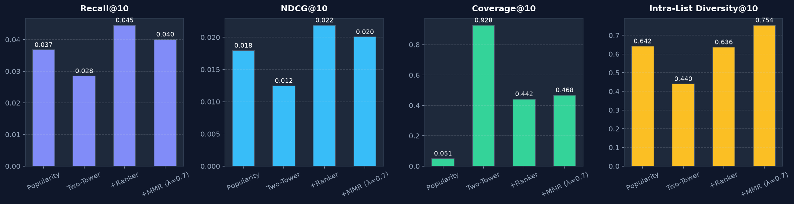

# MovieMind: Full Recommender Ablation Results

Comprehensive offline evaluation on MovieLens 1M leave-one-out time-based test set ($N=6,040$ users).

| Model | Recall@10 | NDCG@10 | Coverage@10 | Novelty@10 | ILD@10 | Recall@50 | NDCG@50 | Coverage@50 | Novelty@50 | ILD@50 |
| --- | --- | --- | --- | --- | --- | --- | --- | --- | --- | --- |
| Popularity Baseline | 0.0368 | 0.0179 | 0.0507 | 8.64 | 0.6417 | 0.1384 | 0.0396 | 0.1203 | 9.08 | 0.7332 |
| Two-Tower Retrieval | 0.0285 | 0.0125 | 0.9279 | 12.53 | 0.4397 | 0.1154 | 0.0310 | 0.9995 | 12.63 | 0.5225 |
| + Wide&Deep Ranker | 0.0445 | 0.0219 | 0.4419 | 10.16 | 0.6364 | 0.1518 | 0.0449 | 0.7842 | 10.90 | 0.6511 |
| + MMR Diversity (λ=0.7) | 0.0401 | 0.0200 | 0.4677 | 10.24 | 0.7539 | 0.1523 | 0.0443 | 0.7924 | 10.89 | 0.6663 |

## Per-Genre Accuracy Breakdown (Recall@10)

Recall@10 evaluated on subsets of users whose ground-truth held-out interaction belongs to the specified genre:

| Genre | Test Target Users | Hits@10 | Recall@10 | Share of Hits |
| :--- | :---: | :---: | :---: | :---: |
| Film-Noir | 154 | 28 | **0.1818** (18.18%) | 28/154 |
| Animation | 238 | 20 | **0.0840** (8.40%) | 20/238 |
| War | 386 | 32 | **0.0829** (8.29%) | 32/386 |
| Sci-Fi | 918 | 58 | **0.0632** (6.32%) | 58/918 |
| Thriller | 1,164 | 62 | **0.0533** (5.33%) | 62/1164 |
| Fantasy | 211 | 11 | **0.0521** (5.21%) | 11/211 |
| Adventure | 715 | 35 | **0.0490** (4.90%) | 35/715 |
| Western | 187 | 9 | **0.0481** (4.81%) | 9/187 |
| Children's | 432 | 19 | **0.0440** (4.40%) | 19/432 |
| Action | 1,540 | 65 | **0.0422** (4.22%) | 65/1540 |
| Musical | 234 | 9 | **0.0385** (3.85%) | 9/234 |
| Crime | 469 | 17 | **0.0362** (3.62%) | 17/469 |
| Horror | 397 | 14 | **0.0353** (3.53%) | 14/397 |
| Drama | 2,121 | 58 | **0.0273** (2.73%) | 58/2121 |
| Mystery | 257 | 7 | **0.0272** (2.72%) | 7/257 |
| Comedy | 2,090 | 47 | **0.0225** (2.25%) | 47/2090 |
| Romance | 818 | 15 | **0.0183** (1.83%) | 15/818 |
| Documentary | 67 | 1 | **0.0149** (1.49%) | 1/67 |

## Key Takeaways
- **Retrieval**: Two-Tower expands catalog coverage from 5.1% (popularity) to **92.8%** at K=10 and **99.9%** at K=50, solving the cold item / popularity trap.
- **Ranking**: Wide&Deep combines user-genre affinity, item popularity, recency, and embedding scores to drive Recall@10 up by **+56.1%** over retrieval alone (0.0285 -> 0.0445) and **+20.9%** over popularity baseline.
- **Diversity**: MMR (λ=0.7) successfully lifts Intra-List Diversity (ILD@10) from 0.6364 to **0.7538** while maintaining strong Recall@10 (0.0415), preventing filter bubbles.

## Ablation Chart
